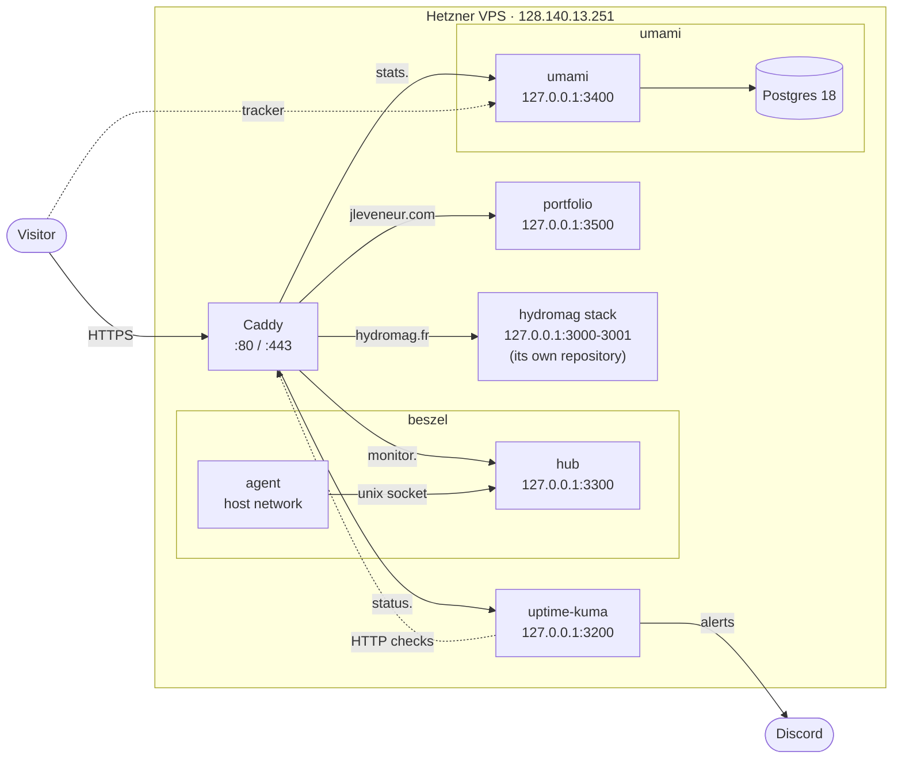
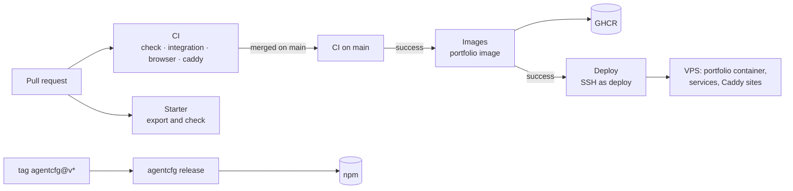

# Architecture

What this repository builds and where each piece runs: the portfolio on the
VPS, the services the VPS shares between sites, the starter, and the npm
package. [AGENTS.md](../AGENTS.md) holds the code's rules; this page is the
map around them. It stays out of the starter export, like `deploy/`.

## At a glance

| Piece                                  | Where it ends up                                | Shipped by                                                                                   |
| -------------------------------------- | ----------------------------------------------- | -------------------------------------------------------------------------------------------- |
| `apps/portfolio`                       | jleveneur.com, a standalone Next.js container   | [images.yml](../.github/workflows/images.yml), [deploy.yml](../.github/workflows/deploy.yml) |
| `deploy/uptime-kuma`                   | status.jleveneur.com                            | [deploy.yml](../.github/workflows/deploy.yml)                                                |
| `deploy/beszel`                        | monitor.jleveneur.com                           | [deploy.yml](../.github/workflows/deploy.yml)                                                |
| `deploy/umami`                         | stats.jleveneur.com, stats.hydromag.fr          | [deploy.yml](../.github/workflows/deploy.yml)                                                |
| `apps/starter` and the shared packages | new repositories, through `bun run new-project` | checked by [starter.yml](../.github/workflows/starter.yml)                                   |
| `packages/agentcfg`                    | npm, `@jleveneur/agentcfg`                      | [agentcfg-release.yml](../.github/workflows/agentcfg-release.yml)                            |

The VPS also runs Hydromag (hydromag.fr, admin.hydromag.fr), which has its own
repository, deploy user and `docs/architecture.md`. Uptime Kuma, Beszel and
Umami serve both projects, which is why they are versioned here.



## The monorepo

Bun workspaces and Turborepo; [AGENTS.md](../AGENTS.md#2-repository-shape)
lists the apps and packages and the allowed dependency direction. Three things
share it:

- **The starter.** `apps/starter`, the packages it uses, `tooling/` and the
  root configuration form a Next.js template (Better Auth, organizations,
  oRPC). `bun run new-project <directory>` exports it as a new repository,
  with `templates/next/` replacing the root files that name this repository's
  own projects. [scripts/new-project.ts](../scripts/new-project.ts) leaves out
  the portfolio, `agentcfg`, `deploy/`, the workflows and this page.
- **The portfolio.** `apps/portfolio`, a bilingual site (French at `/`,
  English at `/en`) built with `output: "standalone"` and shipped as a Docker
  image ([its Dockerfile](../apps/portfolio/Dockerfile)), the same way as
  Hydromag's apps. The pages are prerendered; the server is there for the
  contact form, a Server Action that sends through Resend. Its environment is
  its own (`src/lib/env.ts`), not `@repo/env`, and its one secret is
  `RESEND_API_KEY`.
- **agentcfg.** A CLI published to npm, which imports no `@repo/*` package and
  builds to `dist/` for Node 22.13 and later.

## Pipelines



- **CI** ([ci.yml](../.github/workflows/ci.yml)): format, lint, typecheck,
  Knip, React Doctor and unit tests (`Check`), the Postgres-backed suites
  (`Integration`), the apps in Chromium (`Browser`), and `caddy validate` plus
  `caddy fmt` on [deploy/caddy](../deploy/caddy) (`Caddy`), against the same
  Caddy version as the server.
- **Starter** ([starter.yml](../.github/workflows/starter.yml)) exports the
  starter on every pull request and checks that the result installs and
  passes its own checks.
- **agentcfg** ([agentcfg.yml](../.github/workflows/agentcfg.yml)) tests the
  package when it changes; pushing a tag `agentcfg@v<version>` runs
  [agentcfg-release.yml](../.github/workflows/agentcfg-release.yml), which
  publishes to npm through trusted publishing (OIDC, with provenance) and
  creates the GitHub release. No npm token is stored.
- **Images** ([images.yml](../.github/workflows/images.yml)) builds the
  portfolio's image once CI has passed on `main` and pushes it to GHCR as
  `ghcr.io/jleveneur/jleveneur-portfolio:<sha>` (and `latest`). A pull request
  that touches the Dockerfile builds it without pushing.
- **Deploy** ([deploy.yml](../.github/workflows/deploy.yml)) runs once Images
  has published, and by hand with a commit SHA to roll back or forward.

### What a deploy does

Over SSH as `deploy`, everything from the commit being deployed:

1. **Variables.** The `production` environment's values are written to
   `/srv/jleveneur/.env`, `/srv/umami/.env`, `/srv/beszel/.env`,
   `/srv/backup/r2.env` and `/srv/backup/backup.env` (600), each replaced file
   kept as `<file>.previous`. All are built before any is sent: a missing
   required value stops the job with nothing written.
2. **Portfolio.** [deploy/portfolio/compose.yml](../deploy/portfolio/compose.yml)
   goes to `/srv/jleveneur/`, `release.env` pins `PORTFOLIO_TAG` to the
   commit, and the image is pulled with the run's `GITHUB_TOKEN` (no registry
   credential stays on the server). `up --wait` fails the job unless the new
   container answers its healthcheck. Images stay in GHCR, so a rollback
   needs no rebuild, back to the first commit that had one.
3. **Services.** For each of `uptime-kuma`, `beszel` and `umami`, the commit's
   `deploy/<service>/compose.yml` goes to `/srv/<service>/`, then
   `docker compose up -d --pull missing --remove-orphans --wait`. Images are
   pinned to a version, so a service whose file did not change keeps running
   untouched, and a Renovate bump reaches the server once merged.
4. **Caddy.** The four sites files go into `/etc/caddy/sites/` with a single
   `systemctl reload caddy`. The previous ones wait in
   `/srv/jleveneur/caddy/previous/` and go back if Caddy refuses the new ones.
5. **Checks.** jleveneur.com, `/en` and `/contact` (200), www (301), and the
   health endpoints of the three services must answer. Then images unused for two weeks are pruned.

### Adding a service

The workflow cannot create directories in `/srv` or files in
`/etc/caddy/sites`, so a new service starts with one step as root: create
`/srv/<service>` and an empty `/etc/caddy/sites/<service>.caddy`, both
owned by `deploy`. Then add `deploy/<service>/compose.yml` and
`deploy/caddy/<service>.caddy`, pick a port range (below), add the service to
`SERVICES` in the workflow and a URL check; if it has secrets, add them,
prefixed by the service, to the workflow's "Write the production variables"
step and to [deploy/vps/github-env.sh](../deploy/vps/github-env.sh), and push
them before merging.

## The server

A Hetzner Cloud VPS: Ubuntu 26.04 LTS, 2 vCPU, 4 GB of RAM plus a 2 GB swap
file, 40 GB of disk. Only SSH (22) and Caddy (80, 443) listen on the public
interface; every service publishes on `127.0.0.1`.

### DNS

`jleveneur.com` is at Cloudflare, with DNS records only (no proxy): `@` and
the wildcard `*` point to the VPS. A new subdomain therefore needs no DNS
change, only a Caddy site, and Caddy obtains its certificate on the first
request. `www.jleveneur.com` redirects to the apex. `hydromag.fr` has its own
DNS at OVH.

### Caddy

Caddy 2.11.7 runs on the host as a systemd service. Its global
`/etc/caddy/Caddyfile` belongs to no repository: it imports
`/etc/caddy/sites/*.caddy`, and each project versions its own file. Snippet
names carry the project's prefix because every file shares one namespace.

| Project     | Ports     | Sites file          | Defined in |
| ----------- | --------- | ------------------- | ---------- |
| hydromag    | 3000–3099 | `hydromag.caddy`    | hydromag   |
| jleveneur   | 3500–3599 | `jleveneur.caddy`   | this repo  |
| uptime-kuma | 3200–3299 | `uptime-kuma.caddy` | this repo  |
| beszel      | 3300–3399 | `beszel.caddy`      | this repo  |
| umami       | 3400–3499 | `umami.caddy`       | this repo  |

[jleveneur.caddy](../deploy/caddy/jleveneur.caddy) compresses and proxies
jleveneur.com to the portfolio container on 127.0.0.1:3500. The security
headers (HSTS with `includeSubDomains` and `preload`, a partial CSP,
`X-Frame-Options`, `nosniff`, `Referrer-Policy`, `Permissions-Policy`) come
from the app's `next.config.ts`, as do the 404 page and the cache headers of
`/_next/static/*`. Access logs go to `/var/log/caddy/<project>.access.log`; they roll daily and are
deleted after 90 days, as both sites' privacy policies promise. Caddy applies a
change to the log options on `systemctl restart caddy`, not on the reload a
deploy runs.

### Accounts

| User     | Can                                                                                                                                                                                        |
| -------- | ------------------------------------------------------------------------------------------------------------------------------------------------------------------------------------------ |
| `julien` | Administration: SSH key, `sudo` with a password, docker group                                                                                                                              |
| `deploy` | Both repositories' deploys: owns every project directory in `/srv` and its sites file; docker group; only `sudo systemctl reload caddy` and `sudo systemctl start hydromag-backup.service` |

One deploy account and one key for the whole VPS, set up by
[deploy/vps/deploy-user.sh](../deploy/vps/deploy-user.sh). The docker group
makes that key root-equivalent on the server anyway, so per-project accounts
separated nothing. It lives only in the `production` environment of the two
repositories that deploy here; a personal GitHub account has no secrets shared
between repositories, so
[deploy/vps/github-secrets.sh](../deploy/vps/github-secrets.sh) sets the same
values in both, and rotating the key is running it again.

### Directories

```
/srv/jleveneur/
├── compose.yml                     copied by each deploy
├── .env                            RESEND_API_KEY, EMAIL_FROM, CONTACT_TO (600, deploy-written)
├── release.env                     PORTFOLIO_TAG: the deployed commit
└── caddy/previous/                 sites files before the last deploy
/srv/uptime-kuma/compose.yml
/srv/beszel/{compose.yml,.env}      .env: the agent's KEY and TOKEN (600, deploy-written)
/srv/umami/{compose.yml,.env}       .env: database password, APP_SECRET… (600, deploy-written)
/srv/backup/
├── r2.env                          the R2 key every backup shares (600, deploy-written)
├── backup.env                      optional: this backup's HEARTBEAT_URL (600, deploy-written)
└── jleveneur-backup.sh             copied by each deploy
```

## The shared services

| Service                                          | Image                                    | Data                                   | Notes                                                                                                                                                                                      |
| ------------------------------------------------ | ---------------------------------------- | -------------------------------------- | ------------------------------------------------------------------------------------------------------------------------------------------------------------------------------------------ |
| [Uptime Kuma](../deploy/uptime-kuma/compose.yml) | `louislam/uptime-kuma:*-slim`            | volume `data` (SQLite)                 | Monitors the public URLs and receives the Hydromag backup heartbeat; alerts on Discord                                                                                                     |
| [Beszel](../deploy/beszel/compose.yml)           | `henrygd/beszel`, `henrygd/beszel-agent` | volumes `data`, `agent-data`, `socket` | The agent runs on the host network with the Docker socket read-only, and talks to the hub over a unix socket                                                                               |
| [Umami](../deploy/umami/compose.yml)             | `ghcr.io/umami-software/umami`           | its own Postgres 18, volume `db-data`  | Cookie-free analytics for hydromag.fr and jleveneur.com; telemetry off. Hydromag's staff use it at stats.hydromag.fr with a view-only account in the Hydromag team, which owns hydromag.fr |

Sign-in to each dashboard is the service's own; the subdomains add nothing in
front. Their secrets are in the GitHub `production` environment, prefixed by
service (`UMAMI_APP_SECRET`, `BESZEL_AGENT_TOKEN`…), and each deploy writes
them to `/srv/<service>/.env`.

The portfolio's tracker is in its root layout with `data-domains="jleveneur.com"`,
so `next dev` and the e2e runs load the script without recording visits.

**Backups.** Every night at 03:45 Paris time, `jleveneur-backup.timer` runs
[deploy/backup/backup.sh](../deploy/backup/backup.sh): a `pg_dump` of Umami,
online SQLite copies of Uptime Kuma's and Beszel's databases (with the Beszel
hub's key, which its agents know), each checked, then uploaded to
`jleveneur-backups` on Cloudflare R2 (EU jurisdiction). Hydromag's database
goes to the same bucket from its own repository. One key, `/srv/backup/r2.env`
(written by each deploy from the `R2_*` values of the `production`
environment), limited to that
bucket and to the VPS's addresses; the bucket refuses to overwrite or delete
any object for 30 days and deletes them after 90. Restoring needs only the
server: the steps are in the script's header.

**Limits.** The three services run on the server they watch, so a server that
goes down cannot report itself: that takes a probe from outside.

## Where configuration lives

| What                                   | Where                                                              |
| -------------------------------------- | ------------------------------------------------------------------ |
| `DEPLOY_SSH_KEY`, `DEPLOY_KNOWN_HOSTS` | GitHub, `production` environment secrets                           |
| `DEPLOY_ENABLED`, `DEPLOY_HOST`        | GitHub repository variables                                        |
| Portfolio, service and backup secrets  | GitHub, `production` environment secrets, prefixed by service      |
| Their other values                     | GitHub, `production` environment variables                         |
| The copy of both to keep               | a local env file outside Git, pushed by `deploy/vps/github-env.sh` |
| npm publishing                         | trusted publishing on npmjs.com, no token                          |
| Dependency updates                     | [renovate.json](../renovate.json), three-day release-age delay     |

## Operations

| Task              | How                                                                                      |
| ----------------- | ---------------------------------------------------------------------------------------- |
| Deploy            | Merge to `main`                                                                          |
| Roll back         | Run the Deploy workflow with an older commit's SHA                                       |
| Bump a service    | Change its image tag in `deploy/<service>/compose.yml` and merge                         |
| A service's logs  | `docker compose logs -f` in `/srv/<service>`                                             |
| Portfolio's logs  | `docker compose logs -f` in `/srv/jleveneur`                                             |
| Change a value    | Edit the local env file, `bash deploy/vps/github-env.sh <file>`, run the Deploy workflow |
| Restart a service | `docker compose up -d` in `/srv/<service>`                                               |
| Release agentcfg  | See [packages/agentcfg/README.md](../packages/agentcfg/README.md)                        |
