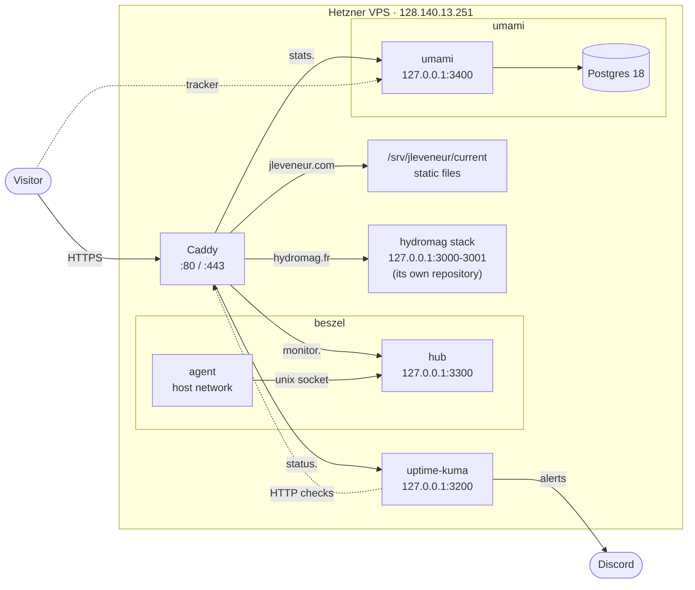
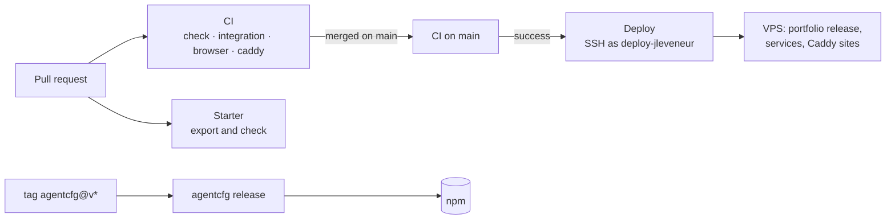

# Architecture

What this repository builds and where each piece runs: the portfolio on the
VPS, the services the VPS shares between sites, the starter, and the npm
package. [AGENTS.md](../AGENTS.md) holds the code's rules; this page is the
map around them. It stays out of the starter export, like `deploy/`.

## At a glance

| Piece                                  | Where it ends up                                | Shipped by                                                        |
| -------------------------------------- | ----------------------------------------------- | ----------------------------------------------------------------- |
| `apps/portfolio`                       | jleveneur.com, a static export served by Caddy  | [deploy.yml](../.github/workflows/deploy.yml)                     |
| `deploy/uptime-kuma`                   | status.jleveneur.com                            | [deploy.yml](../.github/workflows/deploy.yml)                     |
| `deploy/beszel`                        | monitor.jleveneur.com                           | [deploy.yml](../.github/workflows/deploy.yml)                     |
| `deploy/umami`                         | stats.jleveneur.com, stats.hydromag.fr          | [deploy.yml](../.github/workflows/deploy.yml)                     |
| `apps/starter` and the shared packages | new repositories, through `bun run new-project` | checked by [starter.yml](../.github/workflows/starter.yml)        |
| `packages/agentcfg`                    | npm, `@jleveneur/agentcfg`                      | [agentcfg-release.yml](../.github/workflows/agentcfg-release.yml) |

The VPS also runs Hydromag (hydromag.fr, admin.hydromag.fr), which has its own
repository, deploy user and `docs/architecture.md`. Uptime Kuma, Beszel and
Umami serve both projects, which is why they are versioned here.



## The monorepo

Bun workspaces and Turborepo; [AGENTS.md](../AGENTS.md#2-repository-shape)
lists the apps and packages and the allowed dependency direction. Three things
share it:

- **The starter.** `apps/starter`, the packages it uses, `tooling/` and the
  root configuration form a Next.js template (Better Auth, organizations,
  oRPC). `bun run new-project <directory>` exports it as a new repository,
  with `templates/next/` replacing the root files that name this repository's
  own projects. [scripts/new-project.ts](../scripts/new-project.ts) leaves out
  the portfolio, `agentcfg`, `deploy/`, the workflows and this page.
- **The portfolio.** `apps/portfolio`, a single page with no server-side code.
  `build:export` (`PORTFOLIO_EXPORT=1 next build`) writes it to `out/` as
  static files. It has no environment and no secret.
- **agentcfg.** A CLI published to npm, which imports no `@repo/*` package and
  builds to `dist/` for Node 22.13 and later.

## Pipelines



- **CI** ([ci.yml](../.github/workflows/ci.yml)): format, lint, typecheck,
  Knip, React Doctor and unit tests (`Check`), the Postgres-backed suites
  (`Integration`), the apps in Chromium (`Browser`), and `caddy validate` plus
  `caddy fmt` on [deploy/caddy](../deploy/caddy) (`Caddy`), against the same
  Caddy version as the server.
- **Starter** ([starter.yml](../.github/workflows/starter.yml)) exports the
  starter on every pull request and checks that the result installs and
  passes its own checks.
- **agentcfg** ([agentcfg.yml](../.github/workflows/agentcfg.yml)) tests the
  package when it changes; pushing a tag `agentcfg@v<version>` runs
  [agentcfg-release.yml](../.github/workflows/agentcfg-release.yml), which
  publishes to npm through trusted publishing (OIDC, with provenance) and
  creates the GitHub release. No npm token is stored.
- **Deploy** ([deploy.yml](../.github/workflows/deploy.yml)) runs once CI has
  passed on `main`, and by hand with a commit SHA to roll back or forward.

### What a deploy does

Over SSH as `deploy-jleveneur`, everything from the commit being deployed:

1. **Portfolio.** `rsync` of `out/` into `/srv/jleveneur/releases/<sha>/`, then
   one `mv -T` of the `current` symlink, so Caddy never serves a half-synced
   site. The five latest releases stay, so a rollback needs no rebuild.
2. **Services.** For each of `uptime-kuma`, `beszel` and `umami`, the commit's
   `deploy/<service>/compose.yml` goes to `/srv/<service>/`, then
   `docker compose up -d --pull missing --remove-orphans --wait`. Images are
   pinned to a version, so a service whose file did not change keeps running
   untouched, and a Renovate bump reaches the server once merged.
3. **Caddy.** The four sites files go into `/etc/caddy/sites/` with a single
   `systemctl reload caddy`. The previous ones wait in
   `/srv/jleveneur/caddy/previous/` and go back if Caddy refuses the new ones.
4. **Checks.** jleveneur.com (200), www (301), and the health endpoints of the
   three services must answer. Then images unused for two weeks are pruned.

### Adding a service

The workflow cannot create directories in `/srv` or files in
`/etc/caddy/sites`, so a new service starts with one step as root: create
`/srv/<service>` and its `.env` if it has secrets, and an empty
`/etc/caddy/sites/<service>.caddy`, all owned by `deploy-jleveneur`. Then add
`deploy/<service>/compose.yml` and `deploy/caddy/<service>.caddy`, pick a port
range (below), add the service to `SERVICES` in the workflow and a URL check,
and merge.

## The server

A Hetzner Cloud VPS: Ubuntu 26.04 LTS, 2 vCPU, 4 GB of RAM plus a 2 GB swap
file, 40 GB of disk. Only SSH (22) and Caddy (80, 443) listen on the public
interface; every service publishes on `127.0.0.1`.

### DNS

`jleveneur.com` is at Cloudflare, with DNS records only (no proxy): `@` and
the wildcard `*` point to the VPS. A new subdomain therefore needs no DNS
change, only a Caddy site, and Caddy obtains its certificate on the first
request. `www.jleveneur.com` redirects to the apex. `hydromag.fr` has its own
DNS at OVH.

### Caddy

Caddy 2.11.7 runs on the host as a systemd service. Its global
`/etc/caddy/Caddyfile` belongs to no repository: it imports
`/etc/caddy/sites/*.caddy`, and each project versions its own file. Snippet
names carry the project's prefix because every file shares one namespace.

| Project     | Ports     | Sites file          | Defined in |
| ----------- | --------- | ------------------- | ---------- |
| hydromag    | 3000–3099 | `hydromag.caddy`    | hydromag   |
| jleveneur   | static    | `jleveneur.caddy`   | this repo  |
| uptime-kuma | 3200–3299 | `uptime-kuma.caddy` | this repo  |
| beszel      | 3300–3399 | `beszel.caddy`      | this repo  |
| umami       | 3400–3499 | `umami.caddy`       | this repo  |

[jleveneur.caddy](../deploy/caddy/jleveneur.caddy) sends the security
headers (HSTS with `includeSubDomains` and `preload`, a partial CSP,
`X-Frame-Options`, `nosniff`, `Referrer-Policy`, `Permissions-Policy`), serves
the export with `try_files {path} {path}.html {path}/index.html`, answers
unknown paths with `404.html`, and caches `/_next/static/*` as immutable.
Access logs go to `/var/log/caddy/<project>.access.log`.

### Accounts

| User               | Can                                                                                                                                            |
| ------------------ | ---------------------------------------------------------------------------------------------------------------------------------------------- |
| `julien`           | Administration: SSH key, `sudo` with a password, docker group                                                                                  |
| `deploy-jleveneur` | Owns `/srv/jleveneur`, `/srv/uptime-kuma`, `/srv/beszel`, `/srv/umami` and their sites files; docker group; only `sudo systemctl reload caddy` |
| `deploy-hydromag`  | The same for Hydromag                                                                                                                          |

The docker group makes a deploy key root-equivalent on the server, which is
why each lives only in its repository's `production` environment.

### Directories

```
/srv/jleveneur/
├── current -> releases/<sha>       what Caddy serves
├── releases/<sha>/                 the five latest exports
└── caddy/previous/                 sites files before the last deploy
/srv/uptime-kuma/compose.yml
/srv/beszel/{compose.yml,.env}      .env: the agent's KEY and TOKEN (600)
/srv/umami/{compose.yml,.env}       .env: database password, APP_SECRET… (600)
```

## The shared services

| Service                                          | Image                                    | Data                                   | Notes                                                                                                                                                                                      |
| ------------------------------------------------ | ---------------------------------------- | -------------------------------------- | ------------------------------------------------------------------------------------------------------------------------------------------------------------------------------------------ |
| [Uptime Kuma](../deploy/uptime-kuma/compose.yml) | `louislam/uptime-kuma:*-slim`            | volume `data` (SQLite)                 | Monitors the public URLs and receives the Hydromag backup heartbeat; alerts on Discord                                                                                                     |
| [Beszel](../deploy/beszel/compose.yml)           | `henrygd/beszel`, `henrygd/beszel-agent` | volumes `data`, `agent-data`, `socket` | The agent runs on the host network with the Docker socket read-only, and talks to the hub over a unix socket                                                                               |
| [Umami](../deploy/umami/compose.yml)             | `ghcr.io/umami-software/umami`           | its own Postgres 18, volume `db-data`  | Cookie-free analytics for hydromag.fr and jleveneur.com; telemetry off. Hydromag's staff use it at stats.hydromag.fr with a view-only account in the Hydromag team, which owns hydromag.fr |

Sign-in to each dashboard is the service's own; the subdomains add nothing in
front. Secrets are generated on the server into `/srv/<service>/.env` and
never leave it.

The portfolio's tracker is in its root layout with `data-domains="jleveneur.com"`,
so `next dev` and the e2e runs load the script without recording visits.

**Limits.** The three services run on the server they watch, so a server that
goes down cannot report itself: that takes a probe from outside. Their volumes
are not backed up: losing the server loses the analytics history and the
monitors' configuration, not the sites, which are rebuilt from Git.

## Where configuration lives

| What                                   | Where                                                          |
| -------------------------------------- | -------------------------------------------------------------- |
| `DEPLOY_SSH_KEY`, `DEPLOY_KNOWN_HOSTS` | GitHub, `production` environment secrets                       |
| `DEPLOY_ENABLED`, `DEPLOY_HOST`        | GitHub repository variables                                    |
| Service secrets                        | `/srv/<service>/.env` on the server                            |
| npm publishing                         | trusted publishing on npmjs.com, no token                      |
| Dependency updates                     | [renovate.json](../renovate.json), three-day release-age delay |

## Operations

| Task              | How                                                               |
| ----------------- | ----------------------------------------------------------------- |
| Deploy            | Merge to `main`                                                   |
| Roll back         | Run the Deploy workflow with an older commit's SHA                |
| Bump a service    | Change its image tag in `deploy/<service>/compose.yml` and merge  |
| A service's logs  | `docker compose logs -f` in `/srv/<service>`                      |
| Restart a service | `docker compose up -d` in `/srv/<service>`                        |
| Release agentcfg  | See [packages/agentcfg/README.md](../packages/agentcfg/README.md) |
